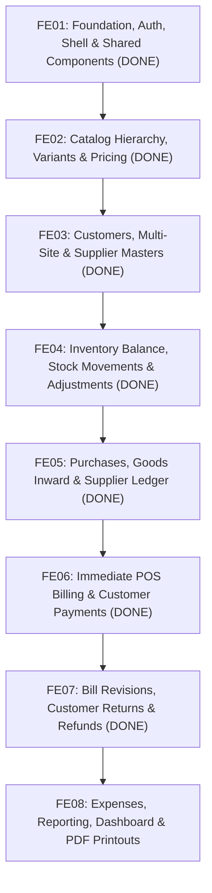

# Himmat Enterprises — Frontend Portal (FE01 through FE07)

Production-ready frontend application for **Himmat Enterprises** (Hardware, Electrical & Paint Shop Management).
Covers:
* **FE01**: Foundation, Authentication, Role Guards & Shell Layout
* **FE02**: Product Catalog Hierarchy, Sellable Variants & Pricing Management
* **FE03**: Customer Management, Customer Multi-Sites & Supplier Masters
* **FE04**: Inventory Balances, Immutable Stock Movements & Multi-Line Manual Adjustments
* **FE05**: Purchases, Inward Entry, Supplier Payments, Credit Allocation, Returns & Supplier Ledger
* **FE06**: Immediate Counter Invoicing, Customer Receipts, Credit Allocation, Customer Ledger & 30-Day Dues
* **FE07**: Versioned Invoice Corrections, Customer Returns, Refunds & Complete Bill History

---

## 1. Technology Architecture

* **Framework & Runtime**: React 18.3.1 with TypeScript 5.6.3, built with Vite 6.0.3
* **Routing**: React Router 6.28.0 (declarative nested layouts and role guards)
* **Styling**: Tailwind CSS 3.4.16 with responsive container utilities and PostCSS
* **Server State & Data Fetching**: TanStack React Query 5.62.7
  * Bounded safe reads (`retry: 1`, `staleTime: 30s`)
  * Financial, catalog, party, billing revisions, returns, and inventory adjustments mutations strictly non-retrying (`retry: 0`)
* **HTTP Client**: Axios 1.7.9 with correlation/request ID parsing and structured error envelopes
* **Forms & Validation**: React Hook Form 7.54.1 & Zod 3.24.1
* **Icons**: Lucide React 0.468.0
* **Exact Decimal Math**: `decimal.js` 10.4.3 (prevents IEEE-754 precision loss on monetary figures)
* **Testing Suite**: Vitest 2.1.9 with React Testing Library 16.1.0 and JSDOM 25.0.1 (137 tests across 18 test suites)

---

## 2. Visual Language & Design System Tokens

Adapted from the Daddy Soda admin interface reference, tailored for an enterprise single-location hardware and paint store:

| Design Token | CSS / Tailwind Class | Hex / Spec | Usage |
|---|---|---|---|
| **Primary Accent** | `bg-teal-700 hover:bg-teal-800` | `#0f766e` / `#115e59` | Primary buttons, active nav pills, key icons |
| **Active Nav Surface** | `bg-teal-50 text-teal-900 border-teal-200` | `#f0fdfa` / `#134e4a` | Highlighted active sidebar items |
| **Canvas Background** | `bg-slate-50` | `#f8fafc` | Main screen background |
| **Card Surfaces** | `bg-white border-slate-200 rounded-xl` | `#ffffff` / `#e2e8f0` | Content cards, data tables, modals |
| **Headings & Body** | `text-slate-900`, `text-slate-700` | `#0f172a`, `#334155` | Typographic hierarchy |
| **Muted Captions** | `text-slate-500` | `#64748b` | Subtitles, timestamps, helper text |
| **Success Badge** | `bg-emerald-50 text-emerald-800 border-emerald-200` | `#ecfdf5` / `#065f46` | Active status, paid balance, in-stock |
| **Danger / Due Badge** | `bg-red-50 text-red-800 border-red-200` | `#fef2f2` / `#991b1b` | Inactive status, overdue receivables, zero stock |
| **Warning Badge** | `bg-amber-50 text-amber-800 border-amber-200` | `#fffbeb` / `#92400e` | Low stock alerts, 409 stale version conflict, debit notes |
| **Info / Method Badge**| `bg-sky-50 text-sky-800 border-sky-200` | `#f0f9ff` / `#075985` | MRP Discount pricing method, contractor badges |

### Branding & Identity
* **Application Title**: `Himmat Enterprises`
* **Wordmark**: Clean, accessible text wordmark with building emblem (no fabricated logos or fake franchise graphics).
* **Single Location**: Focus on counter retail and contractor billing without multi-tenant franchise overhead.

---

## 3. Catalog Hierarchy & Pricing Management (FE02)

### 3.1 Entity Hierarchy
```
Brand (e.g. Supreme, Finolex, Asian Paints)
  └── Category (e.g. PVC Pipes, Paints)
        ├── Purchase Discount % (0-100)
        └── Sales Discount % (0-100)
        └── Subcategory (e.g. Rigid PVC, Emulsion)
              └── Master Product (e.g. Agriculture Delivery Pipe)
                    └── Product Variant / SKU (e.g. 40mm x 3m Class 3)
```

### 3.2 Pricing Methods & Rules
1. **MRP Discount (`MRP_DISCOUNT`)**:
   * Requires `mrpInclTax` (₹, Incl. GST).
   * Automatically resolves the parent Category `salesDiscountPct` as `CATEGORY_SALES_DISCOUNT` unless an explicit line discount override is provided.
2. **Cost Plus Margin (`COST_PLUS`)**:
   * Requires `purchaseCostExclTax` (₹, Excl. GST), `profitPct` (Target Margin %), and `gstRatePct`.
   * Calculates Selling Price = `Cost × (1 + Margin%) × (1 + GST%)`.
   * **Rule: Category sales discount does NOT apply to Cost-Plus variants.**
3. **Fixed Price (`FIXED`)**:
   * Requires `fixedPriceInclTax` (₹, Incl. GST).
   * **Rule: Strictly prohibits any discount.** (Backend throws `ValidationException` if discount > 0).

### 3.3 Inventory Balance Constraint on Creation
* Creating a variant via `POST /api/v1/variants` atomically creates an `inventory_balance` row initialized to `quantityOnHand = 0, openingConfirmed = false`.
* **The frontend intentionally omits any opening stock field during variant creation.** Opening counts are verified exclusively through initial stocktaking / stock adjustments (FE04).

---

## 4. Parties, Customer Multi-Site & Supplier Masters (FE03)

### 4.1 Customer Types & Data Model
Customers represent billing entities and are categorized into three business types:
* **`RETAIL`**: Walk-in counter customers.
* **`CONTRACTOR`**: Plumbing, painting, and electrical contractors purchasing for job sites.
* **`BUILDER`**: Real estate and commercial construction accounts.

### 4.2 Customer Multi-Site Model
* One customer can have zero, one, or many material-delivery sites.
* Each site has an independent label (`siteName`), destination address, contact person, phone number, and active flag.
* A sale invoice links to exactly one Customer and optionally to one of that Customer's active sites.

### 4.3 Reusable Selectors
* **`CustomerSelector`**: Debounced search by code, name, or phone.
* **`CustomerSiteSelector`**: Filtered by chosen customer, auto-selects if single site.
* **`SupplierSelector`**: Searchable dropdown showing supplier code, name, and phone.

---

## 5. Inventory Balances, Movements & Adjustments (FE04)

### 5.1 Business Rules & Single-Store Invariants
* Single inventory ledger per variant (`quantityOnHand` integer pieces).
* Negative stock is strictly prohibited across all roles including Owner.
* Every balance change generates an immutable `StockMovement` entry with business reason and audit timestamp.

---

## 6. Purchases, Inward Entry, Supplier Settlement & Ledger (FE05)

### 6.1 Purchase Entry (`/purchases/new`)
* **Header**: Supplier selector, supplier invoice number, invoice date, commercial notes.
* **Line Items**: Sellable variant selector, whole integer quantity (>= 1), price basis (`GST_INCLUSIVE` vs `GST_EXCLUSIVE`), unit price, discount % (0-100), GST rate (0%, 5%, 12%, 18%, 28%), and optional "Update Master Product Cost" toggle.
* **Tax Basis Calculations (Decimal.js)**:
  * `GST_EXCLUSIVE`: `discountedExcl = unitPrice * (1 - disc%/100)`; `gross = discountedExcl * (1 + gst%/100)`; `tax = discountedExcl * gst%/100`. GST rate is mandatory.
  * `GST_INCLUSIVE`: `gross = unitPrice * (1 - disc%/100)`. If GST rate is provided, net cost is extracted: `net = gross / (1 + gst%/100)`; `tax = gross - net`.
* **Immediate Settlement**: Optional tender via `PaymentComponentsInput` (`CASH`, `ONLINE` with reference), supporting full, partial, or credit purchase.
* **Two-Step Review Confirmation**: Modal verifies PO header, line count, tax breakdown, and total payable before final idempotent dispatch.
* **Inventory Invariant**: Immediately increments `quantityOnHand` in inventory and records `PURCHASE_RECEIPT` movements.

### 6.2 Purchases List & Detail (`/purchases`, `/purchases/:id`)
* **List**: Debounced search, supplier filter, status filter, date range boundaries, total payable, allocated amount, outstanding balance, status badge, and direct PDF download.
* **Detail**: Supplier contact snapshot, financial KPI cards, itemized lines table, and embedded return debit notes.
* **Document PDF**: Authenticated PDF stream via `GET /api/v1/purchases/:id/pdf`.

### 6.3 Purchase Returns & Debit Notes (`PurchaseReturnModal`)
* **Debit Note Entry**: Created against an existing posted purchase invoice.
* **Quantity Limits**: Each return line enforces `quantity <= remainingQuantity` (`quantity - returnedQuantity`).
* **Rate Protection**: Uses the inward historical gross unit rate (never current catalog price).
* **Inventory Protection**: Reduces variant `quantityOnHand`. The backend strictly rejects returns that would drive stock below zero.
* **Debit Note PDF**: Streaming PDF voucher via `GET /api/v1/purchases/returns/:id/pdf`.

### 6.4 Supplier Payments & Mixed Tender (`SupplierPaymentModal`)
* **Tendered Modes**: Multi-row `CASH` and `ONLINE` combinations via `PaymentComponentsInput`.
* **Direct Allocation**: Displays unpaid purchases for the supplier with per-line allocation inputs and quick "Max" buttons.
* **Advance Credit Creation**: Any excess payment beyond allocated invoice balances is atomically credited to the supplier's account as unallocated advance.

### 6.5 Unallocated Credit Allocation (`SupplierAllocationModal`)
* **Credit Settlement**: Applies unallocated payment credit to outstanding purchase invoices.
* **Auto-Allocate**: One-click "Auto-Allocate (FIFO)" fills open invoices in chronological order.

### 6.6 Supplier Refunds (`SupplierRefundModal`)
* **Refund Recording**: Records cash or bank refunds from suppliers consuming available unallocated credit.
* **Validation**: Restricts refund amount to `<= unallocatedCredit`.

### 6.7 Supplier Account Summary & Ledger Statement (`/suppliers/:id`)
* **Account Summary Cards**: Signed balance badge (`Shop Owes Supplier` / `Supplier Holds Advance` / `All Settled`), lifetime totals.
* **Ledger Statement Sub-Tab**: Date range filter, Opening Balance, transaction table (`PURCHASE`, `PAYMENT`, `PURCHASE_RETURN`, `REFUND`), running balance Dr/Cr, and downloadable statement PDF.

---

## 7. Sales Billing, Customer Receipts, Advances & Dues (FE06)

### 7.1 Immediate Counter Sales & Invoicing (`/billing/new`)
* **Counter Invoicing**: No sales-order or delivery prerequisite. Bills are posted directly at the counter.
* **Header**: Customer selector (with available advance credit indicator), delivery site selector (filtered to selected customer, optional for shop pickup), invoice date, and display format selector (`NORMAL` vs `GST`).
* **NORMAL vs GST Format Invariant**: Both formats produce the **exact same total payable amount** (`totalPayableAmount`).
* **Line Pricing & Real-Time Authoritative Preview**:
  * Sellable variant selector, positive integer pieces (`quantity >= 1`), base unit price, overridable discount %, overridable unit price with **mandatory reason**.
  * Debounced real-time preview calls `POST /api/v1/invoices/preview` returning line breakdowns, tax splits, warnings, and cryptographic `pricingFingerprint`.
* **Settlement at Bill Generation**:
  * **Apply Available Advance**: Optional checkbox to deduct existing customer advance credit (`applyAdvanceAmount`).
  * **Tendered Payment**: Optional split CASH and ONLINE component input (`receiptComponents`). Excess payment accrues as unallocated customer advance credit.
* **Inventory Deduction**: Atomically deducts variant inventory (`SALE` movements) and appends an `INVOICE` entry to the customer ledger.

### 7.2 Invoices Register & Detail Inspection (`/billing`, `/billing/invoices/:id`)
* **List Screen**: Filter bar, data table with total payable, allocated amount, outstanding due, settlement badge, due date / overdue badge, and PDF download.
* **Detail Screen**: Customer & delivery site snapshot cards, financial KPI cards (Total Payable, Revisions Delta, Total Returned, Effective Payable, Allocated, Outstanding), and tabbed history.
* **Document PDF**: Authenticated PDF stream in either `NORMAL` or `GST` format via `GET /api/v1/invoices/:id/pdf?format=...`.

### 7.3 Customer Financial Summary & Ledger Statement (`/customers/:id`)
* **Financial Overview Cards**: Signed net balance badge (`Customer Owes Shop` / `Customer Advance Credit` / `Settled`), lifetime totals for Total Invoiced, Total Receipts, Unallocated Advance Credit, Outstanding Dues, and Delivery Sites count.
* **Sub-Tabs Architecture**:
  * **Delivery Sites**: Full site list with supervisor, phone, and add/edit modals.
  * **Ledger Statement**: Date range filter, Opening Balance, sequential events table (`INVOICE`, `RECEIPT`, `CUSTOMER_RETURN`, `REFUND`), Debit (+), Credit (-), running balance Dr/Cr, and downloadable PDF statement.
  * **Customer Invoices**: Paginated table of all invoices issued to this customer.
  * **Customer Receipts**: Paginated table of receipts recorded for this customer.
  * **Customer Returns**: Paginated table of return credit notes with Credit Note PDF action.
  * **Customer Refunds**: Paginated table of credit disbursements with Refund Voucher PDF action.

### 7.4 Customer Receipts & Advance Allocations (`CustomerReceiptModal`, `CustomerAllocationModal`)
* **Customer Receipt Modal**: Multi-row `CASH` and `ONLINE` split, open invoices allocation table, and automatic advance credit creation.
* **Advance Credit Allocation Modal**: Discovers receipts holding unallocated credit and applies them to outstanding invoices using FIFO or custom amounts.

### 7.5 Customer Dues & 30-Day Credit Aging (`/dues`)
* **30-Day Payment Terms**: Customer payment terms are strictly **original invoice date + 30 calendar days**. Overdue begins on day 31.
* **Dues Summary KPIs**: Total Outstanding, Total Overdue, Outstanding Invoices Count, Overdue Invoices Count.
* **Aging & Dues Table**: Ordered by due date ascending with customer, site, balances, due date, overdue badges, and instant receipt entry.

---

## 8. Versioned Corrections, Customer Returns & Refunds (FE07)

### 8.1 Confirmed Business Rules & Invariants
1. **No Arbitrary Age Limit**: Legitimate bill corrections and returns have no arbitrary age limit (no 30-day cutoff).
2. **Preserve Original Invoice Identity**: Edits preserve original invoice ID, invoice number, and original invoice date. The due date remains based on original invoice date + 30 days.
3. **Audit Trail via Immutable Linked Revisions**: Overwriting historical data is strictly prohibited. Every bill modification creates a sequentially numbered revision (`Rev #1`, `Rev #2`, etc.) with full snapshot payload and user reason.
4. **Effective Bill Formula**:
   $$\text{Effective Payable} = \text{Original Payable} + \sum \Delta_{\text{Revisions}} - \text{Total Goods Returned}$$
   Returns are subtracted once from the latest revised payable; returns are never double-subtracted.
5. **Inventory Movement Invariant**:
   * `deltaQuantity > 0` $\rightarrow$ records `SALE` (stock OUT, variant must be active).
   * `deltaQuantity < 0` $\rightarrow$ records `REVERSAL` (stock IN, accepts historical inactive variants).
   * Price-only revisions ($\Delta \text{Qty} = 0$) $\rightarrow$ produces **zero stock movements** while updating financial obligations.
   * Customer returns $\rightarrow$ records `CUSTOMER_RETURN` movement (stock IN, restores pieces).
6. **Negative Stock Prohibition**: No revision or return may cause inventory to go below zero for any role, including Owner.
7. **Excess Allocation Release to Advance Credit**: When an invoice revision or customer return decreases the effective payable below the amount already paid/allocated ($\text{Allocated} > \text{Effective Payable}$), the excess is automatically released as customer unallocated advance credit (`releasedAllocationAmount`).

### 8.2 Invoice Revision Workflow (`InvoiceRevisionModal`, `InvoiceRevisionDetailModal`)
* **Modal Trigger**: Accessible from Invoice Detail via "Edit Bill" button.
* **Pre-population**: Pre-populates all existing invoice lines with SKU, current quantities, returned quantities, and prices.
* **Line Quantity Constraints**: Enforces `newQuantity >= returnedQuantity`. Cannot reduce a line below items already returned by the customer. Setting `newQuantity = 0` (if 0 returned) marks the line as `REMOVED`.
* **Price Overrides & Additional Lines**: Allows unit price overrides (with mandatory reason) and appending additional variants via `VariantSelector`.
* **Authoritative Live Preview**: Debounced live preview via `POST /api/v1/invoices/:id/revisions/preview` showing previous vs new totals, delta payable, released credit, and itemized change badges (`UNCHANGED`, `MODIFIED`, `ADDED`, `REMOVED`).
* **Two-Step Review Confirmation**: Requires user confirmation of the summary delta and audit reason before final submission.
* **Idempotent Dispatch**: Dispatched via `POST /api/v1/invoices/:id/revisions` with UUID `Idempotency-Key` and `expectedVersion` for optimistic concurrency locking.
* **Line Diffs Inspection (`InvoiceRevisionDetailModal`)**: Displays an itemized side-by-side diff table comparing previous vs new quantities, rates, and line totals with change badges.
* **Revision PDF Download**: Streaming PDF download via `GET /api/v1/invoices/:id/revisions/:revId/pdf`.

### 8.3 Customer Returns & Credit Notes (`CustomerReturnModal`)
* **Modal Trigger**: Accessible from Invoice Detail via "Record Return" button (disabled when all items are already returned).
* **Return Lines Table**: Displays invoiced quantity, previously returned quantity, and returnable remaining quantity (`quantity - returnedQuantity`). Restricts return quantity input to available returnable pieces.
* **Return Valuation Policy Handling**:
  * If invoice lines underwent historical price revisions (`priceRevised = true`), the backend requires a valuation policy:
    * `ORIGINAL_INVOICE_PRICE`: Value return using original invoice price.
    * `LATEST_REVISED_PRICE`: Value return using the latest revised price.
  * The selector is automatically surfaced with clear explanations and policy badges.
* **Return Preview**: Calls `POST /api/v1/invoices/:id/returns/preview` showing total return credit amount, released allocation, and new outstanding balance.
* **Post-Return State**: After successful submission, presents options to "Keep as Customer Credit" or directly open `CustomerRefundModal` to disburse funds.
* **Credit Note PDF**: Streaming PDF via `GET /api/v1/customer-returns/:id/pdf`.

### 8.4 Customer Refunds & Credit Disbursements (`CustomerRefundModal`)
* **Modal Trigger**: Accessible from Customer Financial Summary via "Issue Refund" button (disabled when unallocated advance credit is 0).
* **Credit Verification**: Discovers unallocated customer credit from `customerFinanceApi.getAccountSummary`. Enforces total refund amount $\le$ available advance credit.
* **Tendered Split**: Supports multi-row `CASH` and `ONLINE` (with UTR/reference) payment methods via `PaymentComponentsInput`.
* **Ledger Impact**: Appends a `REFUND` debit entry to the customer ledger and deducts unallocated advance credit.
* **Refund Voucher PDF**: Streaming PDF via `GET /api/v1/customer-refunds/:id/pdf`.

---

## 9. Route & Module Map

| Route | Access | Module | Status |
|---|---|---|---|
| `/login` | Public | Auth Foundation | **Fully Implemented** |
| `/dashboard` | `OWNER`, `MANAGER` | Reporting | **Fully Implemented** (Operational KPIs; Owner-only profit) |
| `/account` | `OWNER`, `MANAGER` | Identity | **Fully Implemented** (Profile info & password change) |
| `/settings/shop` | `OWNER`, `MANAGER` | Settings | **Fully Implemented** (Versioned shop configuration) |
| `/users` | `OWNER` only | Identity Admin | **Fully Implemented** (User CRUD with last-active-Owner protections) |
| `/catalog/products` | `OWNER`, `MANAGER` | Catalog (FE02) | **Fully Implemented** (Search, brand/cat/subcat filters, CRUD) |
| `/catalog/products/:id` | `OWNER`, `MANAGER` | Catalog (FE02) | **Fully Implemented** (Product detail, variant table & modal) |
| `/catalog/brands` | `OWNER`, `MANAGER` | Catalog (FE02) | **Fully Implemented** (Brand listing, creation, versioned edits) |
| `/catalog/categories` | `OWNER`, `MANAGER` | Catalog (FE02) | **Fully Implemented** (Category listing, separate discounts) |
| `/catalog/subcategories` | `OWNER`, `MANAGER` | Catalog (FE02) | **Fully Implemented** (Subcategory listing, category filter) |
| `/catalog/pricing-preview` | `OWNER`, `MANAGER` | Pricing (FE02) | **Fully Implemented** (Read-only pricing simulator) |
| `/customers` | `OWNER`, `MANAGER` | Parties (FE03) | **Fully Implemented** (Customer list, type filter, create/edit, status toggle) |
| `/customers/:id` | `OWNER`, `MANAGER` | Parties & Finance (FE03/FE06/FE07) | **Fully Implemented** (Contact info, sites, financial KPIs, ledger statement, invoices, receipts, returns, refunds, Issue Refund modal) |
| `/suppliers` | `OWNER`, `MANAGER` | Parties (FE03) | **Fully Implemented** (Supplier list, create/edit modal, status toggle) |
| `/suppliers/:id` | `OWNER`, `MANAGER` | Parties & Finance (FE03/FE05) | **Fully Implemented** (Contact info, Account Summary, Ledger Statement, Purchases & Payments) |
| `/inventory` | `OWNER`, `MANAGER` | Inventory (FE04) | **Fully Implemented** (Balances table, brand/category/status filters, adjust action) |
| `/inventory/variants/:variantId` | `OWNER`, `MANAGER` | Inventory (FE04) | **Fully Implemented** (Variant stock detail, audit version, recent movements) |
| `/inventory/movements` | `OWNER`, `MANAGER` | Inventory (FE04) | **Fully Implemented** (Immutable ledger, direction/type/date filters) |
| `/purchases` | `OWNER`, `MANAGER` | Purchases (FE05) | **Fully Implemented** (Purchases list, filters, status, PDF download) |
| `/purchases/new` | `OWNER`, `MANAGER` | Purchases (FE05) | **Fully Implemented** (Multi-line purchase entry, tax calculations, review step) |
| `/purchases/:id` | `OWNER`, `MANAGER` | Purchases (FE05) | **Fully Implemented** (Purchase detail, return modal, lines table, PDF) |
| `/billing` | `OWNER`, `MANAGER` | Billing (FE06) | **Fully Implemented** (Invoices list, filter bar, status badges, PDF download) |
| `/billing/new` | `OWNER`, `MANAGER` | Billing (FE06) | **Fully Implemented** (Immediate POS billing, preview fingerprint, advance & payments) |
| `/billing/invoices/:id` | `OWNER`, `MANAGER` | Billing (FE06/FE07) | **Fully Implemented** (Invoice detail, effective payable cards, Active Lines tab, Revisions History tab with line diffs, Returns History tab, Receipts tab, Revision/Return/Receipt modals, PDF downloads) |
| `/dues` | `OWNER`, `MANAGER` | Dues (FE06) | **Fully Implemented** (30-day dues aging, overdue filters, summary KPIs, instant receipt) |
| `/forbidden` | Protected | Access Control | **Fully Implemented** (403 Access Denied) |
| `*` | Any | Routing | **Fully Implemented** (404 Not Found) |
| `/expenses` | `OWNER`, `MANAGER` | Expenses | Coming in FE08 (Operating Expenses & Reports) |
| `/reports` | `OWNER`, `MANAGER` | Reporting | Coming in FE08 (Profit & Analytics) |

---

## 10. Session & In-Memory Authentication Lifecycle

1. **In-Memory Token Store**:
   * The Bearer JWT access token is stored **strictly in-memory** (`authStore.ts`).
   * It is **never** saved to `localStorage`, `sessionStorage`, `IndexedDB`, cookies, or URL parameters.
   * Page reload safely returns to login without silent token leaks.
2. **Stateless Bearer Interception**:
   * Outgoing requests automatically inject `Authorization: Bearer <token>`.
3. **401 Unauthorized Expiry**:
   * On receiving `401`, session expires once cleanly, query cache is cleared (`queryClient.clear()`), and user is redirected to `/login?redirect=...`.
4. **403 Forbidden Access**:
   * On receiving `403`, an access denied state is displayed without logging the user out.
5. **Session Invalidation on Password Change**:
   * When an authenticated user updates their password via `POST /api/v1/auth/change-password`, all active JWT tokens are invalidated by the backend. The frontend immediately clears local session state and redirects to login with an informational notice.

---

## 11. Frontend Module Implementation Roadmap



---

## 12. Verification & Quality Gates

Run the verification suite:
```bash
# TypeScript verification & Vite production build
npm run build

# Automated Vitest Suite (137 tests across 18 test suites)
npm test
```
