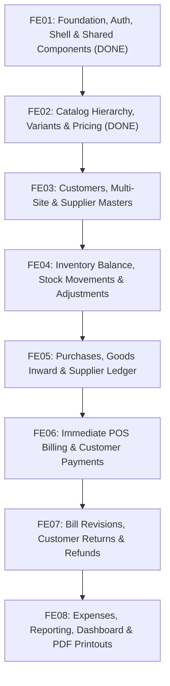

# Himmat Enterprises — Frontend Portal (FE01 & FE02)

Production-ready frontend application for **Himmat Enterprises** (Hardware, Electrical & Paint Shop Management).
Covers **FE01 (Foundation, Authentication & Shell)** and **FE02 (Product Catalog Hierarchy, Variants & Pricing Management)**.

---

## 1. Technology Architecture

* **Framework & Runtime**: React 18.3.1 with TypeScript 5.6.3, built with Vite 6.0.3
* **Routing**: React Router 6.28.0 (declarative nested layouts and role guards)
* **Styling**: Tailwind CSS 3.4.16 with responsive container utilities and PostCSS
* **Server State & Data Fetching**: TanStack React Query 5.62.7
  * Bounded safe reads (`retry: 1`, `staleTime: 30s`)
  * Financial/catalog mutations strictly non-retrying (`retry: 0`)
* **HTTP Client**: Axios 1.7.9 with correlation/request ID parsing and structured error envelopes
* **Forms & Validation**: React Hook Form 7.54.1 & Zod 3.24.1
* **Icons**: Lucide React 0.468.0
* **Exact Decimal Math**: `decimal.js` 10.4.3 (prevents IEEE-754 precision loss on monetary figures)
* **Testing Suite**: Vitest 2.1.9 with React Testing Library 16.1.0 and JSDOM 25.0.1 (47 tests across 8 test suites)

---

## 2. Visual Language & Design System Tokens

Adapted from the Daddy Soda admin interface reference, tailored for an enterprise single-location hardware and paint store:

| Design Token | CSS / Tailwind Class | Hex / Spec | Usage |
|---|---|---|---|
| **Primary Accent** | `bg-teal-700 hover:bg-teal-800` | `#0f766e` / `#115e59` | Primary buttons, active nav pills, key icons |
| **Active Nav Surface** | `bg-teal-50 text-teal-900 border-teal-200` | `#f0fdfa` / `#134e4a` | Highlighted active sidebar items |
| **Canvas Background** | `bg-slate-50` | `#f8fafc` | Main screen background |
| **Card Surfaces** | `bg-white border-slate-200 rounded-xl` | `#ffffff` / `#e2e8f0` | Content cards, data tables, modals |
| **Headings & Body** | `text-slate-900`, `text-slate-700` | `#0f172a`, `#334155` | Typographic hierarchy |
| **Muted Captions** | `text-slate-500` | `#64748b` | Subtitles, timestamps, helper text |
| **Success Badge** | `bg-emerald-50 text-emerald-800 border-emerald-200` | `#ecfdf5` / `#065f46` | Active status, paid balance, in-stock |
| **Danger / Due Badge** | `bg-red-50 text-red-800 border-red-200` | `#fef2f2` / `#991b1b` | Inactive status, overdue receivables, zero stock |
| **Warning Badge** | `bg-amber-50 text-amber-800 border-amber-200` | `#fffbeb` / `#92400e` | Low stock alerts, 409 stale version conflict |
| **Info / Method Badge**| `bg-sky-50 text-sky-800 border-sky-200` | `#f0f9ff` / `#075985` | MRP Discount pricing method |

### Branding & Identity
* **Application Title**: `Himmat Enterprises`
* **Wordmark**: Clean, accessible text wordmark with building emblem (no fabricated logos or fake franchise graphics).
* **Single Location**: Focus on counter retail and contractor billing without multi-tenant franchise overhead.

---

## 3. Catalog Hierarchy & Pricing Management (FE02)

### 3.1 Entity Hierarchy
```
Brand (e.g. Supreme, Finolex, Asian Paints)
  └── Category (e.g. PVC Pipes, Paints)
        ├── Purchase Discount % (0-100)
        └── Sales Discount % (0-100)
        └── Subcategory (e.g. Rigid PVC, Emulsion)
              └── Master Product (e.g. Agriculture Delivery Pipe)
                    └── Product Variant / SKU (e.g. 40mm x 3m Class 3)
```

### 3.2 Pricing Methods & Rules
1. **MRP Discount (`MRP_DISCOUNT`)**:
   * Requires `mrpInclTax` (₹, Incl. GST).
   * Automatically resolves the parent Category `salesDiscountPct` as `CATEGORY_SALES_DISCOUNT` unless an explicit line discount override is provided.
2. **Cost Plus Margin (`COST_PLUS`)**:
   * Requires `purchaseCostExclTax` (₹, Excl. GST), `profitPct` (Target Margin %), and `gstRatePct`.
   * Calculates Selling Price = `Cost × (1 + Margin%) × (1 + GST%)`.
   * **Rule: Category sales discount does NOT apply to Cost-Plus variants.**
3. **Fixed Price (`FIXED`)**:
   * Requires `fixedPriceInclTax` (₹, Incl. GST).
   * **Rule: Strictly prohibits any discount.** (Backend throws `ValidationException` if discount > 0).

### 3.3 Inventory Balance Constraint on Creation
* Creating a variant via `POST /api/v1/variants` atomically creates an `inventory_balance` row initialized to `quantityOnHand = 0, openingConfirmed = false`.
* **The frontend intentionally omits any opening stock field during variant creation.** Opening counts are verified exclusively through initial stocktaking / stock adjustments (FE04).

### 3.4 Concurrency & Optimistic Locking (`expectedVersion`)
* All update endpoints (`PATCH /api/v1/brands/:id`, `/categories/:id`, `/subcategories/:id`, `/products/:id`, `/variants/:id`) require the entity's current `expectedVersion`.
* On receiving `409 CONFLICT`, the UI surfaces an inline error: *"Conflict: This record was modified by another user. Please refresh and retry."*

### 3.5 Read-Only Pricing Calculator (`/catalog/pricing-preview`)
* Interactive multi-line simulation tool calling `POST /api/v1/pricing/preview`.
* Computes net inclusive prices, resolves category vs explicit discount sources, and splits taxable amount vs GST.
* Profit margins are displayed **exclusively for Owner roles**; for Managers, profit columns remain hidden as enforced by backend security.
* Does not generate invoices or touch inventory balances.

---

## 4. Route & Module Map

| Route | Access | Module | Status |
|---|---|---|---|
| `/login` | Public | Auth Foundation | **Fully Implemented** |
| `/dashboard` | `OWNER`, `MANAGER` | Reporting | **Fully Implemented** (Operational KPIs; Owner-only profit) |
| `/account` | `OWNER`, `MANAGER` | Identity | **Fully Implemented** (Profile info & password change) |
| `/settings/shop` | `OWNER`, `MANAGER` | Settings | **Fully Implemented** (Versioned shop configuration) |
| `/users` | `OWNER` only | Identity Admin | **Fully Implemented** (User CRUD with last-active-Owner protections) |
| `/catalog/products` | `OWNER`, `MANAGER` | Catalog (FE02) | **Fully Implemented** (Search, brand/cat/subcat filters, CRUD) |
| `/catalog/products/:id` | `OWNER`, `MANAGER` | Catalog (FE02) | **Fully Implemented** (Product detail, variant table & modal) |
| `/catalog/brands` | `OWNER`, `MANAGER` | Catalog (FE02) | **Fully Implemented** (Brand listing, creation, versioned edits) |
| `/catalog/categories` | `OWNER`, `MANAGER` | Catalog (FE02) | **Fully Implemented** (Category listing, separate discounts) |
| `/catalog/subcategories` | `OWNER`, `MANAGER` | Catalog (FE02) | **Fully Implemented** (Subcategory listing, category filter) |
| `/catalog/pricing-preview` | `OWNER`, `MANAGER` | Pricing (FE02) | **Fully Implemented** (Read-only pricing simulator) |
| `/forbidden` | Protected | Access Control | **Fully Implemented** (403 Access Denied) |
| `*` | Any | Routing | **Fully Implemented** (404 Not Found) |
| `/customers` | `OWNER`, `MANAGER` | Parties | Coming in FE03 (Customers, Multi-Site & Suppliers) |
| `/inventory` | `OWNER`, `MANAGER` | Inventory | Coming in FE04 (Inventory Balance & Adjustments) |
| `/purchases` | `OWNER`, `MANAGER` | Purchases | Coming in FE05 (Purchases & Supplier Ledger) |
| `/billing` | `OWNER`, `MANAGER` | Billing | Coming in FE06 (Immediate POS Billing) |
| `/dues` | `OWNER`, `MANAGER` | Dues | Coming in FE06 (Dues & Allocation) |
| `/expenses` | `OWNER`, `MANAGER` | Expenses | Coming in FE08 (Operating Expenses & Reports) |
| `/reports` | `OWNER`, `MANAGER` | Reporting | Coming in FE08 (Profit & Analytics) |

---

## 5. Session & In-Memory Authentication Lifecycle

1. **In-Memory Token Store**:
   * The Bearer JWT access token is stored **strictly in-memory** (`authStore.ts`).
   * It is **never** saved to `localStorage`, `sessionStorage`, `IndexedDB`, cookies, or URL parameters.
   * Page reload safely returns to login without silent token leaks.
   * No fabricated refresh token or fake "remember me" loops.
2. **Stateless Bearer Interception**:
   * Outgoing requests automatically inject `Authorization: Bearer <token>`.
3. **401 Unauthorized Expiry**:
   * On receiving `401`, session expires once cleanly, query cache is cleared (`queryClient.clear()`), and user is redirected to `/login?redirect=...`.
4. **403 Forbidden Access**:
   * On receiving `403`, an access denied state is displayed without logging the user out.
5. **Session Invalidation on Password Change**:
   * When an authenticated user updates their password via `POST /api/v1/auth/change-password`, all active JWT tokens are invalidated by the backend. The frontend immediately clears local session state and redirects to login with an informational notice.

---

## 6. Frontend Module Implementation Roadmap



---

## 7. Verification & Quality Gates

Run the verification suite:
```bash
# TypeScript verification & Vite production build
npm run build

# Automated Vitest Suite (47 tests across 8 suites)
npm test
```
