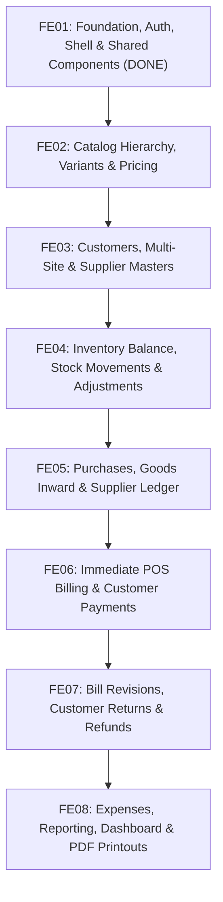

# Himmat Enterprises — Frontend Portal (FE01 Foundation)

Production-ready frontend foundation, authentication layer, responsive admin shell, shared UI design system, and backend integration infrastructure for **Himmat Enterprises** (Hardware, Electrical & Paint Shop Management).

---

## 1. Technology Architecture

* **Framework & Runtime**: React 18.3.1 with TypeScript 5.6.3, built with Vite 6.0.3
* **Routing**: React Router 6.28.0 (declarative nested layouts and route guards)
* **Styling**: Tailwind CSS 3.4.16 with responsive container utilities and PostCSS
* **Server State & Data Fetching**: TanStack React Query 5.62.7
  * Bounded safe reads (`retry: 1`, `staleTime: 30s`)
  * Financial/state mutations strictly non-retrying (`retry: 0`)
* **HTTP Client**: Axios 1.7.9 with correlation/request ID parsing and structured error envelopes
* **Forms & Validation**: React Hook Form 7.54.1 & Zod 3.24.1
* **Icons**: Lucide React 0.468.0
* **Exact Decimal Math**: `decimal.js` 10.4.3 (prevents IEEE-754 precision loss on monetary figures)
* **Testing Suite**: Vitest 2.1.8 with React Testing Library 16.1.0 and JSDOM 25.0.1

---

## 2. Visual Language & Design System Tokens

Adapted from the Daddy Soda admin interface reference, tailored for an enterprise single-location hardware and paint store:

| Design Token | CSS / Tailwind Class | Hex / Spec | Usage |
|---|---|---|---|
| **Primary Accent** | `bg-teal-700 hover:bg-teal-800` | `#0f766e` / `#115e59` | Primary buttons, active nav pills, key icons |
| **Active Nav Surface** | `bg-teal-50 text-teal-900 border-teal-200` | `#f0fdfa` / `#134e4a` | Highlighted active sidebar items |
| **Canvas Background** | `bg-slate-50` | `#f8fafc` | Main screen background |
| **Card Surfaces** | `bg-white border-slate-200 rounded-xl` | `#ffffff` / `#e2e8f0` | Content cards, data tables, modals |
| **Headings & Body** | `text-slate-900`, `text-slate-700` | `#0f172a`, `#334155` | Typographic hierarchy |
| **Muted Captions** | `text-slate-500` | `#64748b` | Subtitles, timestamps, helper text |
| **Success Badge** | `bg-emerald-50 text-emerald-800 border-emerald-200` | `#ecfdf5` / `#065f46` | Active status, paid balance, in-stock |
| **Danger / Due Badge** | `bg-red-50 text-red-800 border-red-200` | `#fef2f2` / `#991b1b` | Inactive status, overdue receivables, zero stock |
| **Warning Badge** | `bg-amber-50 text-amber-800 border-amber-200` | `#fffbeb` / `#92400e` | Low stock alerts, 409 stale version conflict |

### Branding & Identity
* **Application Title**: `Himmat Enterprises`
* **Wordmark**: Clean, accessible text wordmark with building emblem (no fabricated logos or fake franchise graphics).
* **Single Location**: Focus on counter retail and contractor billing without multi-tenant franchise overhead.

---

## 3. Session & In-Memory Authentication Lifecycle

In strict adherence to security and backend specifications:
1. **In-Memory Token Store**:
   * The Bearer JWT access token is stored **strictly in-memory** (`authStore.ts`).
   * It is **never** saved to `localStorage`, `sessionStorage`, `IndexedDB`, cookies, or URL parameters.
   * Page reload safely returns to login without silent token leaks.
   * No fabricated refresh token or fake "remember me" loops.
2. **Stateless Bearer Interception**:
   * Outgoing requests automatically inject `Authorization: Bearer <token>`.
3. **401 Unauthorized Expiry**:
   * On receiving `401`, session expires once cleanly, query cache is cleared (`queryClient.clear()`), and user is redirected to `/login?redirect=...`.
   * Loop guards ensure no endless toast or redirect loops on repeated 401s.
4. **403 Forbidden Access**:
   * On receiving `403`, an access denied state is displayed without logging the user out.
5. **Session Invalidation on Password Change**:
   * When an authenticated user updates their password via `POST /api/v1/auth/change-password`, all active JWT tokens are invalidated by the backend. The frontend immediately clears local session state and redirects to login with an informational notice.

---

## 4. Concurrency, Idempotency & Optimistic Locking

### 4.1 Idempotency Key Lifecycle (`useIdempotentMutation`)
* **Unique Client Key**: Every state-changing financial mutation generates a unique client UUID (`Idempotency-Key: <UUID>`).
* **Uncertain Retry Preservation**: If an HTTP timeout or network disconnect occurs after dispatch, the outcome is uncertain. Calling `retryLastUncertainSubmission()` replays the **exact same** `Idempotency-Key` and **identical payload**, allowing the backend to return the committed result without duplicate side-effects.
* **Payload Drift**: Any user-initiated change to mutation payload automatically generates a new UUID key.
* **No Blind Retries**: Automatic HTTP retries are disabled on mutations (`retry: 0`).

### 4.2 Optimistic Locking (`expectedVersion`)
* Master updates (`/settings/shop`, `/users/:id`) pass the record's current `expectedVersion`.
* On receiving `409 CONFLICT` (error code `STALE_VERSION`), the UI surfaces an inline conflict banner: *"The record was modified by another user. Reload before editing"* and provides a one-click data reload button.

---

## 5. Route & Module Map

| Route | Access | Module | Status in FE01 |
|---|---|---|---|
| `/login` | Public | Auth Foundation | **Fully Implemented** |
| `/dashboard` | `OWNER`, `MANAGER` | Reporting | **Fully Implemented** (Operational KPIs; Owner-only profit) |
| `/account` | `OWNER`, `MANAGER` | Identity | **Fully Implemented** (Profile info & password change) |
| `/settings/shop` | `OWNER`, `MANAGER` | Settings | **Fully Implemented** (Versioned shop configuration) |
| `/users` | `OWNER` only | Identity Admin | **Fully Implemented** (User CRUD with last-active-Owner protections) |
| `/forbidden` | Protected | Access Control | **Fully Implemented** (403 Access Denied) |
| `*` | Any | Routing | **Fully Implemented** (404 Not Found) |
| `/billing` | `OWNER`, `MANAGER` | Billing | Disabled with availability note (FE06) |
| `/customers` | `OWNER`, `MANAGER` | Parties | Disabled with availability note (FE03) |
| `/catalog` | `OWNER`, `MANAGER` | Catalog | Disabled with availability note (FE02) |
| `/inventory` | `OWNER`, `MANAGER` | Inventory | Disabled with availability note (FE04) |
| `/purchases` | `OWNER`, `MANAGER` | Purchases | Disabled with availability note (FE05) |
| `/dues` | `OWNER`, `MANAGER` | Dues | Disabled with availability note (FE06) |
| `/expenses` | `OWNER`, `MANAGER` | Expenses | Disabled with availability note (FE08) |
| `/reports` | `OWNER`, `MANAGER` | Reporting | Disabled with availability note (FE08) |

---

## 6. Role & Permission Matrix

| Feature / Screen | `OWNER` | `MANAGER` | Backend Endpoint |
|---|---|---|---|
| User Login | Yes | Yes | `POST /api/v1/auth/login` |
| View My Profile | Yes | Yes | `GET /api/v1/auth/me` |
| Change My Password | Yes | Yes | `POST /api/v1/auth/change-password` |
| Operational Dashboard | Yes | Yes | `GET /api/v1/dashboard/summary` |
| Owner Profit Metrics | **Yes** (rendered) | **No** (hidden, backend 403) | `GET /api/v1/dashboard/summary` (`profitSummary`) |
| View Shop Settings | Yes | Yes | `GET /api/v1/settings/shop` |
| Update Shop Settings | Yes | Yes | `PATCH /api/v1/settings/shop` |
| List System Users | **Yes** | **No** (Route guard $\rightarrow$ 403) | `GET /api/v1/users` |
| Create Staff Account | **Yes** | **No** (Route guard $\rightarrow$ 403) | `POST /api/v1/users` |
| Update Staff Role / Status | **Yes** | **No** (Route guard $\rightarrow$ 403) | `PATCH /api/v1/users/{id}` |

---

## 7. Shared Component Catalogue

Located in `src/components/ui/` and `src/components/common/`:

1. **Button & IconButton**: Primary (teal-700), secondary, outline, ghost, danger variants; loading spinner; accessible `aria-label` enforcement on icon buttons.
2. **Input & PasswordInput**: Accessible floating labels, error text, helper text, right elements; eye icon toggle for passwords.
3. **Textarea & Select**: Standard styled inputs with accessible `aria-describedby` error bindings.
4. **Checkbox**: Keyboard-navigable checkboxes with optional label and description.
5. **FormField**: Semantic form wrapper managing `id` generation and accessible error/helper linkages.
6. **Card**: Compound card system (`Card`, `CardHeader`, `CardTitle`, `CardDescription`, `CardContent`, `CardFooter`).
7. **Badge**: Status indicators (`default` teal, `success` emerald, `warning` amber, `danger` red, `neutral` slate, `info` sky).
8. **Modal**: Accessible `<dialog>` modal with backdrop blur, light-dismiss, focus containment, and Escape-to-close.
9. **ConfirmationDialog**: Specialized modal for destructive or confirming actions (Sign Out, deletions).
10. **Table**: Data table with typed alignment (`left` for text, `right` for currency/quantities, `center` for badges), responsive overflow container with keyboard scroll (`tabindex="0"`, `role="region"`).
11. **Pagination**: Zero-indexed or one-indexed pagination controls with summary results counter.
12. **SearchFilterToolbar**: Responsive filter and search input bar.
13. **LoadingSkeleton & TableSkeleton**: Pulse animation placeholders for cards, lines, and table rows.
14. **EmptyState**: Dashed card with icon, title, description, and call-to-action button.
15. **ErrorMessage**: Alert banner showing error message, code, and expandable support request ID.
16. **MoneyDisplay**: Exact INR formatting using `decimal.js`, supporting negative amounts, bold colored text, and explicit "Not available" for null/unknown values.
17. **QuantityDisplay**: Discrete whole-unit display (e.g. `15 pcs`).
18. **DateDisplay**: Literal YYYY-MM-DD parsing without UTC shift for business dates, and Asia/Kolkata formatting for timestamps.
19. **downloadPdfDocument**: Robust PDF download helper handling Bearer auth, blob responses, and JSON error extraction.

---

## 8. Daddy Soda Reference Adaptations & Deviations

| Feature / Pattern | Daddy Soda Reference | Himmat Enterprises Implementation | Reason for Adaptation |
|---|---|---|---|
| **Primary Theme** | Emerald-600 / Red-Cream theme | Teal-700 (`#0f766e`) on Slate-50 | Professional hardware & paint business visual identity |
| **Roles** | `SUPER_ADMIN`, `FRANCHISE_OWNER`, `MANAGER` | `OWNER`, `MANAGER` | Single-shop business entity; franchise concepts omitted |
| **Token Storage** | `localStorage` token caching | **Strictly In-Memory token** | High-security financial posture; zero storage persistence |
| **Money Handling** | Standard `parseFloat` / `toFixed` | **Decimal.js exact arithmetic** | Prevents float rounding discrepancies on invoices and ledgers |
| **Quantities** | Decimal litres, syrup bottles, machine fractions | Whole pieces (`Integer`, pcs) | Hardware and paint are sold in discrete whole units |
| **Unread Counters & Polling** | Background local-storage polling | On-demand TanStack Query caching | Clean, battery-efficient, no unrequested polling |
| **Public Elements** | Customer marketing, franchise forms, ROI calculator | Clean administrative management portal | Private business administration tool |

---

## 9. Frontend Module Implementation Roadmap



---

## 10. Verification & Quality Gates

Run the verification suite:
```bash
# TypeScript verification
npm run build

# Automated Vitest Suite (32 tests)
npm test
```
